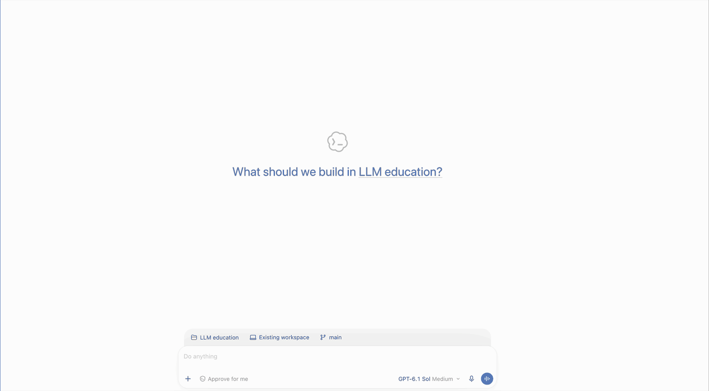

# Интерактивный учебник Java ВШЭ

Интерактивный учебник в чате Codex или Claude Code.



## Как начать

**1. Скачай курс.** Открой Терминал на macOS или Linux либо PowerShell на Windows. Перейди в папку, где хочешь хранить курс, и выполни:

```sh
git clone https://github.com/vyrexd/llm-edu.git
cd llm-edu
```

Если Git ещё не установлен, на странице репозитория нажми **Code → Download ZIP**, распакуй архив и используй распакованную папку.

**2. Открой папку курса.** Выбери всю папку, в которой лежит `README.md`. Java-файлы можно редактировать в приложении агента, если в нём есть редактор, или в любой IDE.

**3. Запусти учебник в одном из агентов.**

- **Codex.** Выбери ту же папку как проект, открой новый чат и отправь **«Начни интерактивный учебник Java»**.
- **Claude Code.** Запусти `claude` из терминала в папке курса и отправь **`/java-course`** в открывшемся чате.

Агент проверит **JDK 26** и **Python 3.9+** и поможет установить то, чего не хватает. Затем он покажет теорию и укажет файл первого упражнения. [Настройка окружения](skills/java-course/setup.md).
